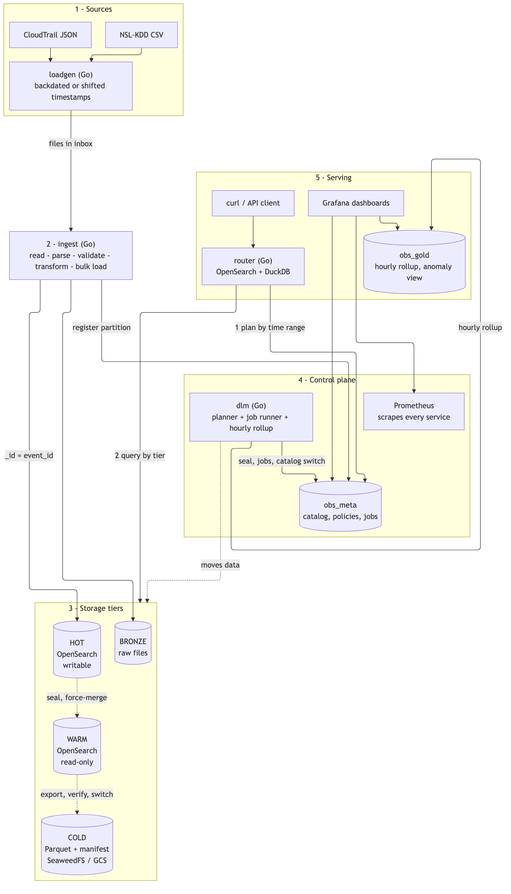
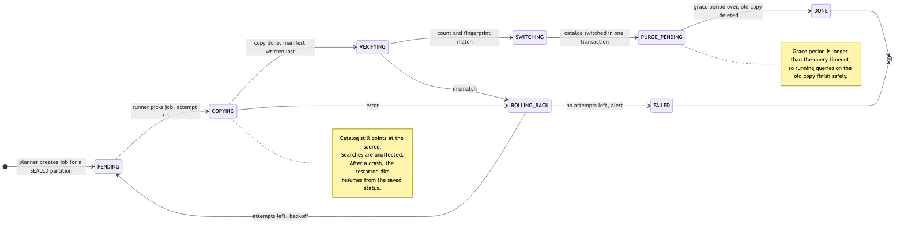
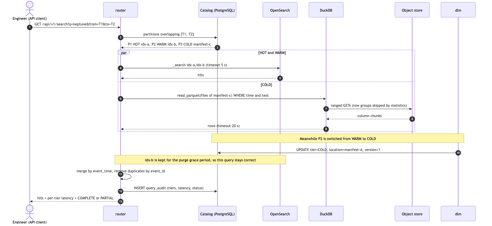

# Observability Fabric: high-level design

| Field | Value |
| --- | --- |
| Document ID | HLD-001 |
| Version | 1.3 |
| Status | Baselined |
| Authors | Group 6: Gajendra Tiwari, Thiru Narayanasamy, Vipul Shukla |
| Approved by | Gajendra Tiwari |
| Date | 2026-11-09 |
| Related | [SRS-001](requirements.md), [LLD-001](lld.md), [ADRs](../adr/README.md), Phase 2 submission (`Project_Phase_2_Group6.docx`) |

## Table of contents

- [1. Introduction](#1-introduction)
- [2. Architecture overview](#2-architecture-overview)
- [3. Data flows](#3-data-flows)
- [4. Storage tiers and zones](#4-storage-tiers-and-zones)
- [5. Design invariants](#5-design-invariants)
- [6. Technology stack](#6-technology-stack)
- [7. Deployment](#7-deployment)
- [8. Cross-cutting concerns](#8-cross-cutting-concerns)
- [9. Key decisions](#9-key-decisions)
- [10. Changes from the Phase 2 design](#10-changes-from-the-phase-2-design)
- [11. Risks](#11-risks)
- [12. Milestones](#12-milestones)
- [13. References](#13-references)
- [14. Revision history](#14-revision-history)

## 1. Introduction

This document describes the architecture of Observability Fabric: its
components, how data flows between them, where data is stored, and how the
system is deployed. It implements the requirements in
[SRS-001](requirements.md). Component internals, schemas, and algorithms are in
[LLD-001](lld.md). Identifiers such as `INV-` (design invariant), `RSK-`
(risk) and `M` (milestone), and all abbreviations, are
defined in the [glossary](../glossary.md).

## 2. Architecture overview

### 2.1 Architecture style

The system is a tiered data lake with a search tier in front of it:

- **HOT and WARM** data lives in OpenSearch, which gives fast full-text search.
- **COLD** data lives as Parquet files in object storage, which is cheap, and
  is searched with DuckDB.
- **A catalog** in PostgreSQL records where every partition is. All search and
  lifecycle decisions go through it.

The system runs locally with Docker Compose. GKE with Google Cloud Storage
(GCS) is a stretch goal that uses the same container image.

### 2.2 System diagram

The system works in three steps:

1. Logs land in HOT.
2. The DLM service moves each partition to cheaper tiers as it ages.
3. The router always asks the catalog where each partition is now, so search
   keeps working during and after every move.

### 2.3 Components

| Component | Type | Responsibility |
| --- | --- | --- |
| `loadgen` | Go service | Produces input files from the NSL-KDD and CloudTrail datasets, with backdated or shifted timestamps, at a chosen volume |
| `ingest` | Go service | Reads input files, stores raw copies in Bronze, converts records to the unified schema, rejects invalid records, and bulk-loads events into HOT |
| `dlm` | Go service | Seals finished partitions, moves partitions HOT → WARM → COLD, deletes them after retention, updates the catalog, and writes the hourly rollup ([ADR-0014](../adr/0014-hourly-rollups-in-dlm.md)) |
| `router` | Go service | Search API. Plans each query from the catalog and queries OpenSearch and DuckDB in parallel |
| OpenSearch | Data store | HOT and WARM full-text index |
| PostgreSQL | Data store | `obs_meta` (catalog and control tables) and `obs_gold` (reporting tables) |
| Object store | Data store | Bronze raw files and COLD Parquet. SeaweedFS locally; GCS on GKE |
| Prometheus | Monitoring | Service metrics, including CPU and memory of each Go service |
| Grafana | Front end | Dashboards RPT-01 to RPT-06 |

## 3. Data flows

### 3.1 Ingest

1. `loadgen` writes input files to the ingest inbox.
2. `ingest` stores each file unchanged in Bronze.
3. Workers parse and validate each record and convert it to the unified
   schema. Invalid records go to `rejected_records`.
4. For the first event in a new time bucket, `ingest` creates the catalog row
   and then the OpenSearch index.
5. Bulk writers load events into the HOT index.

### 3.2 Lifecycle

1. The `dlm` planner seals partitions whose time bucket has ended and that
   have received no writes for a set period.
2. It creates a migration job for each partition that is old enough for its
   next tier.
3. The job runner copies the data, verifies the copy, switches the catalog,
   and deletes the old copy after a grace period.

Each step is saved in PostgreSQL, so an interrupted job resumes where it
stopped.

### 3.3 Search

1. The router reads the catalog for partitions that overlap the requested
   time range.
2. It searches HOT and WARM partitions in OpenSearch, and COLD partitions with
   DuckDB, in parallel with separate timeouts.
3. It merges the results by time, removes duplicates, and labels each hit with
   its tier.

## 4. Storage tiers and zones

| Zone | Technology | Contents | Age (default policy) |
| --- | --- | --- | --- |
| Bronze | Object store, `bronze/` prefix | Raw input files, unchanged | Kept; not deleted automatically in v1.0 |
| HOT | OpenSearch, writable index | Recent events | 0–7 days |
| WARM | OpenSearch, read-only and force-merged | Older events | 7–30 days |
| COLD | Object store, Parquet under `cold/` | Archived events | 30–365 days |
| Catalog and control | PostgreSQL `obs_meta` | Partitions, policies, jobs, batches, rejected records, query audit | n/a |
| Reporting | PostgreSQL `obs_gold` | Hourly rollups, anomaly flags, storage cost | n/a |

A demo policy uses hourly buckets and moves data within minutes
([LLD §7.2](lld.md#72-lifecycle-policies)).

## 5. Design invariants

These rules MUST hold at all times. The failure tests in
[LLD §10.2](lld.md#102-failure-tests) check them.

| ID | Invariant | Enforced by |
| --- | --- | --- |
| INV-1 | The catalog is the only source of truth for where a partition can be read. | The router plans every query from the catalog ([ADR-0004](../adr/0004-catalog-based-query-routing.md)) |
| INV-2 | A location is not deleted while the catalog points to it, or while a running query could still read it. | Old copies are deleted only after the catalog switch plus a grace period longer than the query timeout |
| INV-3 | A partition is sealed before any copy of it starts. | The planner creates jobs only for sealed partitions |
| INV-4 | The catalog switches tier only after the copy has been verified by reading it back. | The `VERIFYING` step ([ADR-0006](../adr/0006-manifest-last-commit-for-cold-writes.md)) |
| INV-5 | Ingesting the same record twice produces one document. | Deterministic `event_id` used as the document ID ([ADR-0011](../adr/0011-deterministic-event-id-from-origin-and-offset.md)) |
| INV-6 | At most one active migration job exists per partition. | Partial unique index on `migration_jobs` |
| INV-7 | Every migration step can be repeated safely. | Saved job state and a separate staging location for each attempt ([ADR-0005](../adr/0005-resumable-single-worker-migration-jobs.md)) |

## 6. Technology stack

| Need | Choice | Why | Alternatives rejected |
| --- | --- | --- | --- |
| Service language | Go | Required by the course. Goroutines and bounded channels suit concurrent pipelines, and services are small | n/a |
| HOT and WARM search | OpenSearch | Inverted index for fast full-text search; APIs give Go full control of tiering; Apache 2.0 | Elasticsearch: default distribution uses the Elastic License. Grafana Loki: indexes labels only, not log text |
| COLD format | Apache Parquet | Columnar, compressed, with statistics and bloom filters for skipping data; an open format | Gzip JSON lines: every query reads every byte |
| COLD query engine | DuckDB, embedded | Runs inside the Go process; reads Parquet straight from object storage; the same engine writes, verifies, and searches ([ADR-0003](../adr/0003-parquet-via-duckdb-for-cold-tier.md)) | Trino: needs a cluster. BigQuery: cloud only, billed per scan |
| Catalog and reporting | PostgreSQL | Transactions, advisory locks, partial unique indexes, `INTERVAL` columns, built-in Grafana data source | MySQL: no partial indexes or `INTERVAL` column type |
| Local object store | SeaweedFS | S3-compatible, Apache 2.0, actively maintained, runs in one container | MinIO: community edition no longer maintained |
| Cloud object store | GCS (stretch goal) | Same cloud as GKE; cheaper Nearline and Coldline storage classes | n/a |
| Object store client | AWS SDK for Go v2 (S3 API) | One client for SeaweedFS and for GCS through its S3-compatible XML API | Separate clients per store |
| Metrics | Prometheus | The Kubernetes standard; Go runtime and process metrics out of the box | `docker stats`: no history |
| Dashboards | Grafana | Real-time dashboards over Prometheus and PostgreSQL; dashboards kept as code | Tableau, Power BI: built for business reports, not live operations |
| Packaging | Docker and Docker Compose | Same image everywhere; one command starts the stack | n/a |
| Cloud runtime | GKE Standard (stretch goal) | Health probes, and separate SSD and standard-disk node pools for HOT and WARM | Autopilot: no control over node pools |
| Build and CI | Make and GitHub Actions | One entry point for every task; tests on every pull request | n/a |
| Exploratory analysis | Python (pandas) | Fast data profiling; never part of the running system | n/a |

## 7. Deployment

### 7.1 Local (Docker Compose)

All services run from one image ([ADR-0009](../adr/0009-single-module-single-image.md))
with `restart: unless-stopped`. The stack needs about 7.5 GB of memory.

| Container | Memory limit |
| --- | --- |
| OpenSearch (single node, 1.5 GB heap) | 3 GB |
| PostgreSQL | 512 MB |
| SeaweedFS (master, volume, filer and S3 in one process) | 1 GB |
| Prometheus | 512 MB |
| Grafana | 512 MB |
| `ingest` | 512 MB |
| `dlm` | 512 MB |
| `router` | 1 GB |
| `loadgen` (run on demand) | Not limited |

OpenSearch's heap and memory limit, and every host port, can be changed in
`.env` for smaller machines or ports already in use
([LLD §7.1](lld.md#71-environment-variables)).

On a single OpenSearch node, WARM means read-only and force-merged, because
there is no second node to move data to.

### 7.2 Cloud (GKE, stretch goal)

- One zonal GKE Standard cluster, created for each test run and deleted
  afterwards.
- OpenSearch installed from its official Helm chart, with a HOT node pool on
  SSD persistent disks and a WARM node pool on standard persistent disks.
- GCS for Bronze and COLD, accessed with HMAC keys stored as Kubernetes
  Secrets.
- Liveness, readiness, and startup probes on every service.

## 8. Cross-cutting concerns

### 8.1 Observability

- Every service exposes `/healthz`, `/readyz`, and `/metrics` and writes JSON
  logs.
- Prometheus scrapes all services. CPU and memory come from each Go
  service's process metrics; cAdvisor was planned, but on Docker Desktop it
  cannot resolve container names.
- RPT-01 (system health report) uses these status thresholds. Ingest
  freshness and OpenSearch cluster health have no metric yet, so the
  dashboard does not show them.

| Signal | Amber | Red |
| --- | --- | --- |
| Service up | n/a | Down for 1 min |
| Ingest freshness p95 | > 30 s | > 60 s |
| Reject rate | > 1 % | > 5 % |
| OpenSearch cluster health | Yellow | Red |
| HOT search p95 | > 1 s | > 2 s |
| Failed DLM jobs in the last 24 h | 1 | 3 or more |

### 8.2 Reliability

| Failure | Behaviour |
| --- | --- |
| OpenSearch slow or down | Channels fill up and ingest pauses (backpressure). Search returns COLD results only, marked `PARTIAL` |
| PostgreSQL down | The router uses its cached catalog and marks results `PARTIAL`. The DLM pauses |
| `dlm` crashes during a migration | Docker restarts it, and the job resumes from its saved step |
| A COLD copy fails verification | The job rolls back and retries. The catalog still points to the old copy |
| An input file is ingested twice | Deterministic event IDs make the second load a no-op |

### 8.3 Security

- Source data is public or synthetic.
- Secrets are kept in an uncommitted `.env` file locally and in Kubernetes
  Secrets on GKE. Secrets MUST NOT be committed.
- Only `dlm` has permission to delete objects.
- All SQL uses bound parameters, and search text is escaped before it is used
  in a pattern.
- TLS is used on GKE. Inside the local Compose network, traffic may be
  unencrypted.

## 9. Key decisions

| ADR | Decision |
| --- | --- |
| [0001](../adr/0001-partition-by-time-bucket.md) | Partition data by time bucket, one index per bucket for all sources |
| [0002](../adr/0002-dlm-owns-all-tier-transitions.md) | The DLM performs every tier transition |
| [0003](../adr/0003-parquet-via-duckdb-for-cold-tier.md) | Store COLD data as Parquet, written and read through DuckDB |
| [0004](../adr/0004-catalog-based-query-routing.md) | Route every query from the catalog |
| [0005](../adr/0005-resumable-single-worker-migration-jobs.md) | Run migrations as resumable jobs with a single worker |
| [0006](../adr/0006-manifest-last-commit-for-cold-writes.md) | Commit COLD writes by writing the manifest last |
| [0007](../adr/0007-interval-based-lifecycle-policies.md) | Express lifecycle policies as intervals |
| [0008](../adr/0008-no-message-queue-in-mvp.md) | Use no message queue in the MVP |
| [0009](../adr/0009-single-module-single-image.md) | Build all services from one Go module into one image |
| [0010](../adr/0010-cold-text-search-by-regex-scan.md) | Search COLD text by regex scan (superseded by ADR-0013) |
| [0011](../adr/0011-deterministic-event-id-from-origin-and-offset.md) | Derive `event_id` from the record's origin and offset |
| [0012](../adr/0012-watchdog-based-liveness-probe.md) | Base the liveness probe on an internal watchdog |
| [0013](../adr/0013-shared-search-text-parser.md) | Parse search text once for all tiers |
| [0014](../adr/0014-hourly-rollups-in-dlm.md) | Build hourly rollups in dlm, without an aggregator service |

## 10. Changes from the Phase 2 design

| Area | Phase 2 | v1.0 | Reason |
| --- | --- | --- | --- |
| Data sources | NSL-KDD, VPC Flow Logs, CloudTrail, HDFS | NSL-KDD and CloudTrail | Two formats are enough to show a unified schema, with less parser work |
| Deployment | Cloud first (GKE) | Local first; GKE as a stretch goal | Lower risk and cost |
| Partitioning | One index per source per day | One index per time bucket for all sources | Avoids about 120 tiny shards at the target volume |
| Policy units | Integer days | Intervals | Lets the demo show tier moves within minutes |
| `event_id` | Hash of record content | Hash of file origin and record offset | A content hash merges identical records that are really separate events |
| Integrity check | Count and per-file SHA-256 | Count and fingerprint, read back from the target | Verifies the full round trip |
| COLD commit | Not specified | Manifest written last | Makes COLD writes atomic |
| Local object store | MinIO | SeaweedFS | MinIO community edition is no longer maintained |
| Tables | 9 in `obs_meta`, 8 in `obs_gold` | 7 in `obs_meta`, 2 in `obs_gold` | Health data comes from Prometheus, and audit data from `obs_meta` |
| Reports | 8 | 6 | Benchmark and anomaly reports merged into others |
| Identifiers | `R1`–`R10` used for both requirements and reports | Separate prefixes (`FR-`, `NFR-`, `RPT-`, …) | Each ID refers to exactly one thing |

## 11. Risks

| ID | Risk | Likelihood | Impact | Mitigation |
| --- | --- | --- | --- | --- |
| RSK-01 | DuckDB's cgo build fails on some team machines or CPU architectures | Medium | High | Spike SP-1 at M0; build only inside Docker |
| RSK-02 | Exporting a large partition to Parquet uses too much memory | Medium | Medium | Page through the index and spool to local disk; spike SP-3 |
| RSK-03 | OpenSearch needs too much memory for laptops | Medium | Medium | Fixed 1.5 GB heap; test at 10 GB, not 100 GB |
| RSK-04 | COLD search is slow | High | Low | Limit the COLD time window; report the measured difference honestly (SQ-4) |
| RSK-05 | Not enough time to finish | Medium | High | Finish the MVP (M0–M4) before any stretch goal |
| RSK-06 | GCS's S3-compatible API lacks a feature we use | Low | Medium | Spike SP-4 before the GKE stretch goal |

## 12. Milestones

| ID | Scope | Exit criteria | Phase |
| --- | --- | --- | --- |
| M0 | Repository, Compose stack, schema migrations, container image, CI; spike SP-1 | `make up` starts the stack, and `/healthz` returns 200 for every service | MVP |
| M1 | `loadgen` and `ingest` for NSL-KDD, then CloudTrail; HOT tier, Bronze, catalog | About 1 GB searchable in OpenSearch; FT-03 passes | MVP |
| M2 | Router over HOT | A search returns hits labelled with their tier; `query_audit` is filled | MVP |
| M3 | DLM sealing and HOT → WARM; demo policy | Partitions move to WARM without manual action | MVP |
| M4 | WARM → COLD, COLD search, retention delete | FT-01 and FT-02 pass with no failed searches | MVP |
| M5 | Hourly rollup and anomaly flag (in `dlm`), dashboards, benchmark, resource profiles | RPT-01 to RPT-06 live; benchmark and profiles reported | Required |
| M6 | GKE deployment with probes, 100 GB run | FT-04 passes; 100 GB results reported | Stretch |

## 13. References

1. Course, "Project 6: Predictive IT Operations (Observability Fabric)", MSDS 432.
2. Group 6, "Final Project Phase 2: Detailed Design", 2026.
3. OpenSearch, ["Point in Time"](https://docs.opensearch.org/latest/search-plugins/searching-data/point-in-time/).
4. DuckDB, ["Parquet Bloom Filters in DuckDB"](https://duckdb.org/2025/03/07/parquet-bloom-filters-in-duckdb), 2025.
5. DuckDB, ["SeaweedFS Import"](https://duckdb.org/docs/stable/guides/network_cloud_storage/seaweedfs_import).
6. DuckDB, [`duckdb-go` README](https://github.com/duckdb/duckdb-go/blob/main/README.md).
7. Grafana Labs, [Loki README](https://github.com/grafana/loki).
8. Revisit.tech, ["MinIO and its alternatives: revisit your self-hosted S3 in 2026"](https://revisit.tech/blog/minio-and-its-alternatives-revisit-your-self-hosted-s3/).
9. Google Cloud, ["Google Kubernetes Engine pricing"](https://cloud.google.com/kubernetes-engine/pricing).
10. M. Nygard, ["Documenting Architecture Decisions"](https://cognitect.com/blog/2011/11/15/documenting-architecture-decisions), 2011.

## 14. Revision history

| Version | Date | Author | Change |
| --- | --- | --- | --- |
| 1.0 | 2026-11-09 | Group 6 | Baseline. Replaces the earlier draft design document |
| 1.1 | 2026-11-27 | Group 6 | `dlm` writes the hourly rollup and there is no `aggregator` service (ADR-0014, §2, §7); ADR-0013 and ADR-0014 added to §9; glossary link in §1 |
| 1.2 | 2026-11-27 | Group 6 | M5 scope without the `aggregator` (§12); Prometheus process metrics instead of cAdvisor (§2, §6, §7, §8.1); SeaweedFS and Grafana memory limits raised to 1 GB and 512 MB after out-of-memory failures (§7.1); removed the open-questions section. Its answers: all three members contribute to every component; the final implementation is due on 7 December 2026; the cloud deployment stays optional, if time permits |
| 1.3 | 2026-11-27 | Group 6 | OpenSearch memory and host ports configurable in `.env` (§7.1) |
