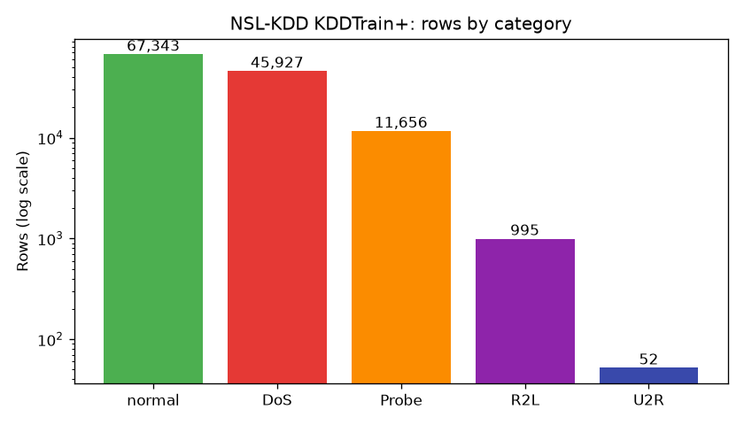
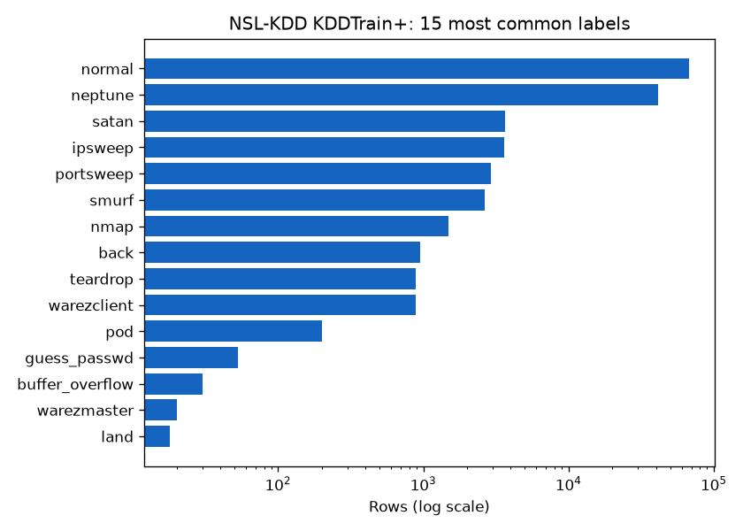
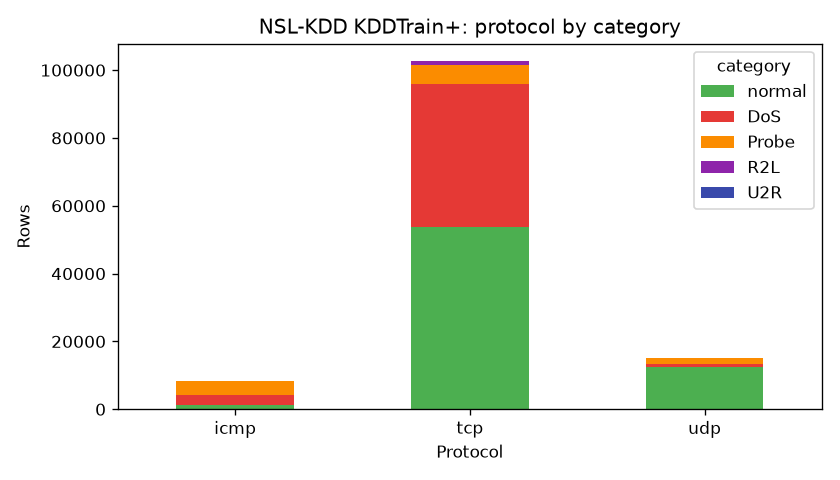
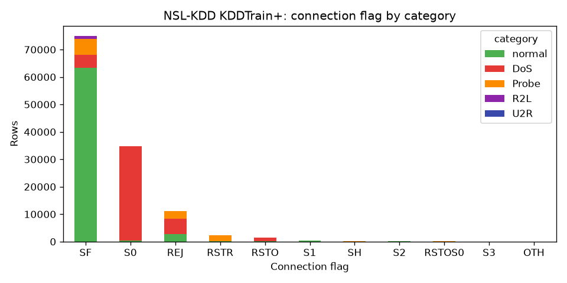
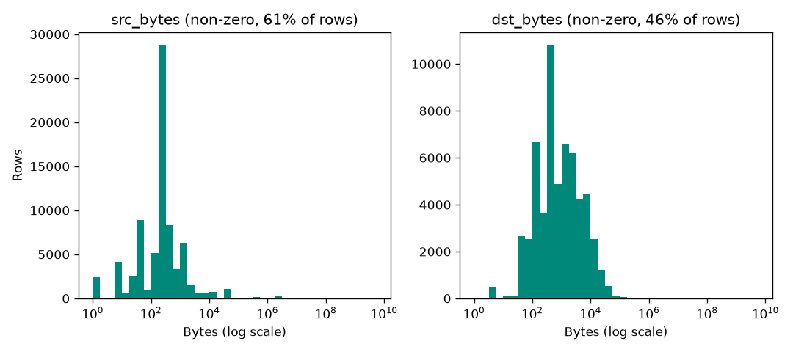
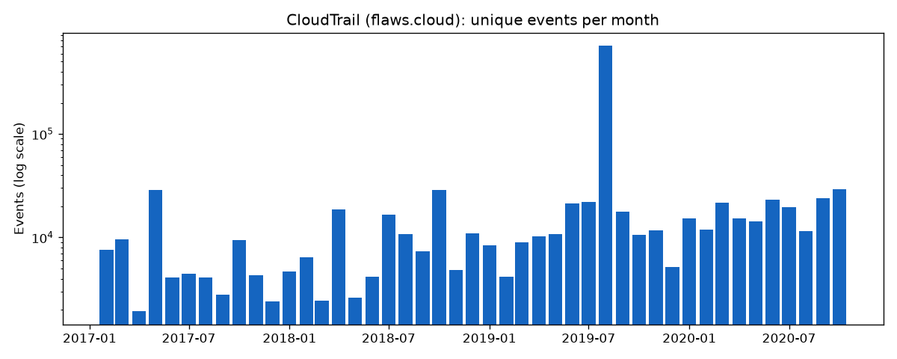
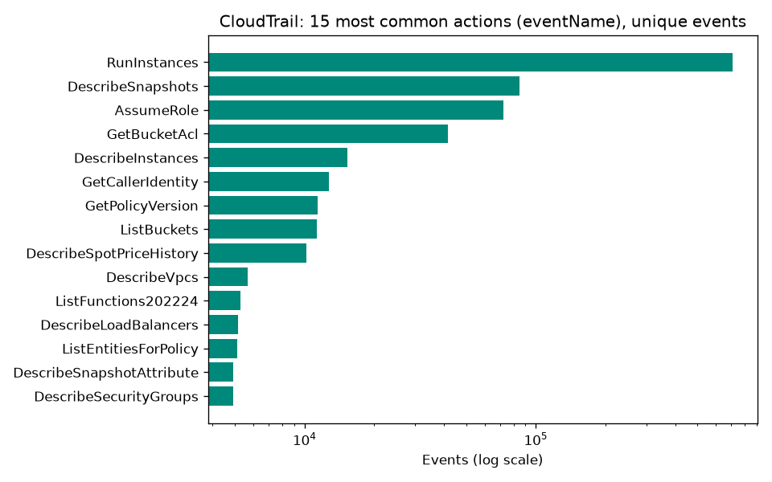
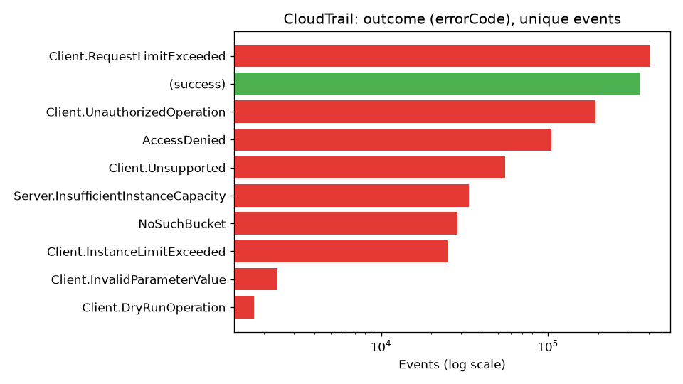
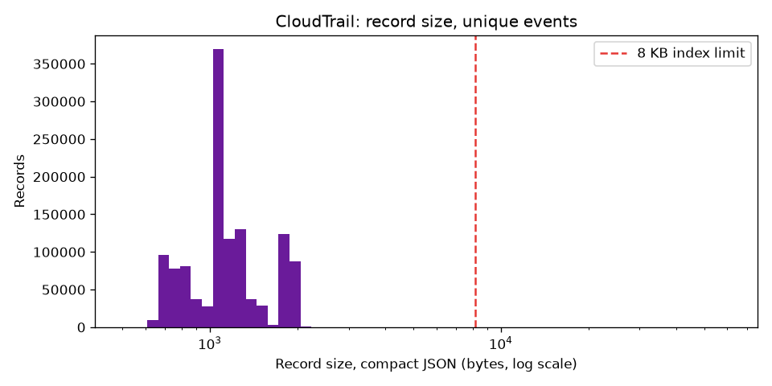

# Observability Fabric: exploratory data analysis

| Field | Value |
| --- | --- |
| Document ID | EDA-001 |
| Version | 1.0 |
| Status | Current |
| Authors | Group 6: Gajendra Tiwari, Thiru Narayanasamy, Vipul Shukla |
| Date | 2026-11-11 |
| Related | [SRS-001](../design/requirements.md), [LLD-001](../design/lld.md), [GUIDE-001](../guides/end-to-end-walkthrough.md) |

## Table of contents

- [1. Summary](#1-summary)
- [2. Scope and method](#2-scope-and-method)
- [3. NSL-KDD](#3-nsl-kdd)
- [4. AWS CloudTrail (flaws.cloud)](#4-aws-cloudtrail-flawscloud)
- [5. Data quality issues and resolutions](#5-data-quality-issues-and-resolutions)
- [6. Proposed design changes](#6-proposed-design-changes)
- [7. Reproducing this analysis](#7-reproducing-this-analysis)
- [8. References](#8-references)
- [9. Revision history](#9-revision-history)

## 1. Summary

This analysis profiles the two input datasets to check that the v1.0 design
handles them correctly. Both datasets are clean at the field level: no
missing values in NSL-KDD, no unparseable timestamps in CloudTrail, and every
record well under the size limits. Four findings affect the design and need a
decision; they are listed in [section 6](#6-proposed-design-changes).

| ID | Finding | Effect on the design |
| --- | --- | --- |
| EDA-F1 | NSL-KDD contains **no duplicate rows** | The reason given in ADR-0011 is wrong; the decision still holds for other reasons |
| EDA-F2 | **36.8 %** of CloudTrail records (713,423) are exact duplicates of another record with the same `eventID` | With the current `event_id` rule, every duplicate would be stored and counted |
| EDA-F3 | CloudTrail spans **3.6 years**; only **17.0 %** of unique events fall within 365 days of the newest one | With the current `loadgen` rule, about 83 % of events would be rejected as `EXPIRED_EVENT` |
| EDA-F4 | **70.8 %** of unique CloudTrail events are failed calls, and the biggest group is throttling (`RequestLimitExceeded`, 33.5 % of all events) | Mapping every failure to `ERROR` would make `ERROR` the normal state, hiding real problems |
| EDA-F5 | One CloudTrail day (22 Aug 2019) holds **24.1 %** of all unique events | A real attack burst: good test data for the anomaly flag (FR-07), but one very large partition |

## 2. Scope and method

### 2.1 Data analysed

| Dataset | Files | Source | SHA-256 |
| --- | --- | --- | --- |
| NSL-KDD | `KDDTrain+.txt`, `KDDTest+.txt` | GitHub mirror `defcom17/NSL_KDD` of the UNB files (the UNB page requires a form); row counts match the published figures | `1b86d2f9…af95` (train), `fa46b093…8f84` (test) |
| AWS CloudTrail | 20 files `flaws_cloudtrail00–19.json.gz` | Summit Route, `flaws_cloudtrail_logs.tar` | `f26c2b8d…96aa` (tar) |

Full checksums are written to `data/raw/SHA256SUMS` by the download script.

### 2.2 Method

- Two Jupyter notebooks in [`eda/`](../../eda/README.md), using Python 3.14
  with pandas and matplotlib:
  [`01_nslkdd_eda.ipynb`](../../eda/01_nslkdd_eda.ipynb) and
  [`02_cloudtrail_eda.ipynb`](../../eda/02_cloudtrail_eda.ipynb). Python is
  used for analysis only, as allowed by NFR-01.
- Every number in this report comes from
  [`results/nslkdd_summary.json`](results/nslkdd_summary.json) or
  [`results/cloudtrail_summary.json`](results/cloudtrail_summary.json), which
  the notebooks write.
- CloudTrail figures are reported for **unique events** (one per `eventID`)
  unless a section says otherwise, because that is what the system should
  store (EDA-F2). Raw-record figures are also in the JSON summary.
- Record sizes are measured as compact JSON (CloudTrail) or line length
  (NSL-KDD), and compared with the limits in LLD-001: 8 KB indexed
  `raw_message` and 64 KB maximum record size.

## 3. NSL-KDD

### 3.1 Shape and quality

| Check | `KDDTrain+` | `KDDTest+` |
| --- | --- | --- |
| Rows | 125,973 | 22,544 |
| Columns | 43 | 43 |
| Missing values | 0 | 0 |
| Exact duplicate rows | 0 | 0 |
| Duplicate rows ignoring `difficulty` | 0 | 0 |
| Distinct labels | 23 | 38 |
| Labels not covered by our category map | 0 | 0 |
| Line length, bytes (min / median / max) | 141 / 151 / 166 | 140 / 152 / 168 |
| Columns with a single value | `num_outbound_cmds` (always 0) | `num_outbound_cmds` (always 0) |

The files are clean. Every line is under 170 bytes, far below the 64 KB
record limit. `num_outbound_cmds` carries no information; it stays in
`raw_message` but needs no field of its own.

### 3.2 Class balance



| Category | Train rows | Train share | Test rows | Test share | Our severity |
| --- | --- | --- | --- | --- | --- |
| normal | 67,343 | 53.5 % | 9,711 | 43.1 % | `INFO` |
| DoS | 45,927 | 36.5 % | 7,458 | 33.1 % | `ERROR` |
| Probe | 11,656 | 9.3 % | 2,421 | 10.7 % | `WARN` |
| R2L | 995 | 0.8 % | 2,754 | 12.2 % | `CRITICAL` |
| U2R | 52 | 0.04 % | 200 | 0.9 % | `CRITICAL` |

The training file is dominated by normal and DoS traffic. R2L and U2R are
rare in training but much more common in the test file, so replaying both
files gives dashboards more variety than the training file alone.



`neptune` (a SYN flood) is by far the most common attack label.

### 3.3 Protocol, connection flag, and service



- **Protocol (train):** TCP 102,689, UDP 14,993, ICMP 8,291.
- **Services:** 70 distinct values in train, 64 in test. The most common are
  `http` (40,338), `private` (21,853), `domain_u` (9,043), `smtp` (7,313), and
  `ftp_data` (6,860).



- **Flag (train):** `SF` 74,945 (completed normally), `S0` 34,851 (no reply),
  `REJ` 11,233 (refused), and eight rarer values.
- Almost all `S0` connections are DoS attacks. This is what a flood looks
  like: many connection attempts that are never answered.

### 3.4 Numeric distributions



| Column (train) | Zero values | Median | 99th percentile | Maximum | Skewness |
| --- | --- | --- | --- | --- | --- |
| `duration` (s) | 92.0 % | 0 | 9,591 | 42,908 | 11.9 |
| `src_bytes` | 39.2 % | 44 | 54,540 | 1,379,963,888 | 190.7 |
| `dst_bytes` | 54.0 % | 0 | 25,519 | 1,309,937,401 | 290.1 |

- Most values are zero, and a few are extremely large. Charts of byte counts
  need a log scale, and anomaly rules should use percentiles or counts, not
  averages of bytes.
- The largest values exceed 1.3 billion, so `bytes` must be a 64-bit integer
  (`long` in OpenSearch, `BIGINT` in Parquet). It already is in LLD-001 §3.1.

### 3.5 Training file versus test file

- **17 attack labels appear only in the test file** (3,750 rows), for example
  `apache2`, `mailbomb`, `saint`, and `snmpguess`. All are covered by our
  category map.
- **610 rows appear in both files** (comparing all features and the label).
  If `loadgen` replays both files, these are separate connections with
  separate IDs, which is correct.
- The `difficulty` column is skewed towards 21, the easiest level: 49.7 % of
  training rows. It describes how hard a row is to classify and is not used
  by the system.

## 4. AWS CloudTrail (flaws.cloud)

### 4.1 Shape and completeness

| Check | Raw records | Unique events |
| --- | --- | --- |
| Records | 1,939,207 | 1,225,784 |
| Unparseable `eventTime` | 0 | 0 |
| Repeated `eventID` | 713,423 | 0 |
| `eventType` = `AwsApiCall` | 99.96 % | 99.9 % |
| `eventVersion` 1.05 | 97.7 % | 96.4 % |

Field presence across raw records:

| Present in every record | Often present | Rarely present |
| --- | --- | --- |
| `eventID`, `eventTime`, `eventName`, `eventSource`, `eventType`, `eventVersion`, `userIdentity`, `sourceIPAddress`, `userAgent`, `awsRegion`, `recipientAccountId`, `requestID` | `requestParameters` 90.9 %, `errorCode` 77.7 %, `errorMessage` 77.3 % | `responseElements` 4.7 %, `resources` 3.5 %, `additionalEventData` 3.3 %, `readOnly` 2.7 % |

Every field our mapping needs (LLD-001 §3.2) is present in every record,
except `errorCode`, which is absent on successful calls by design.

### 4.2 Duplicates

- 713,423 records (36.8 % of the raw file) repeat an `eventID` that was
  already seen.
- **Every one of them is an exact copy**: the full record content, compared
  field by field, is identical.
- 52 of the repeats are in a different file from the first copy; the rest are
  in the same file.
- AWS documents `eventID` as the unique identifier of each event, so these are
  duplicate deliveries, not separate events.

### 4.3 Time coverage



| Measure | Value |
| --- | --- |
| Oldest event | 2017-02-12 19:57 UTC |
| Newest event | 2020-10-07 21:03 UTC |
| Span | 1,333 days (about 3.6 years) |
| Days with no events | 4 |
| Median events per active day | 133.5 |
| Busiest day | 2019-08-22, with 295,844 events (24.1 % of all unique events) |
| Unique events within 365 days of the newest | 17.0 % |
| Unique events within 90 days of the newest | 6.1 % |

Activity is steady at thousands to tens of thousands of events per month,
with one huge burst in August 2019. That burst is a real attack pattern in
the data (see 4.4), which makes it useful for testing the anomaly flag.

### 4.4 Services and actions



- **Services:** 164 distinct `eventSource` values. EC2 accounts for 72.1 % of
  events, followed by STS (7.0 %), S3 (6.2 %), and IAM (4.2 %).
- **Actions:** 1,242 distinct `eventName` values. `RunInstances` (starting
  virtual machines) alone is 57.8 % of unique events, mostly from the August
  2019 burst, typical of an attacker trying to start machines with stolen
  keys.
- **Regions:** 17 distinct regions; `us-west-2` (21.0 %) and `us-east-1`
  (17.5 %) are the busiest.

### 4.5 Outcomes



| Outcome | Unique events | Share of all events | Share of failures |
| --- | --- | --- | --- |
| Success (no `errorCode`) | 358,121 | 29.2 % | n/a |
| `Client.RequestLimitExceeded` (throttled) | 410,209 | 33.5 % | 47.3 % |
| `Client.UnauthorizedOperation` | 192,651 | 15.7 % | 22.2 % |
| `AccessDenied` | 105,220 | 8.6 % | 12.1 % |
| `Client.Unsupported` | 55,496 | 4.5 % | 6.4 % |
| `Server.InsufficientInstanceCapacity` | 33,628 | 2.7 % | 3.9 % |
| `NoSuchBucket` | 28,811 | 2.4 % | 3.3 % |

Most activity in this account failed, as expected for an account that is
attacked on purpose. The failures differ in meaning: throttling means "too
many requests", while `AccessDenied` and `UnauthorizedOperation` mean
"someone tried something they are not allowed to do". The raw data also
contains `Client.DryRunOperation`, which AWS returns when a test request
*would have succeeded*, so it is not a real failure.

### 4.6 Identities and source addresses

| Measure | Unique events |
| --- | --- |
| Identity type `IAMUser` | 91.3 % |
| Identity type `AWSService` | 4.2 % |
| Identity type `AssumedRole` | 3.4 % |
| Identity type `Root` | 0.9 % |
| `userIdentity.arn` missing | 4.5 % (mostly `AWSService` identities) |
| `sourceIPAddress` is an IPv4 address | 95.3 % |
| `sourceIPAddress` is a service name | 4.7 % (top: `ec2.amazonaws.com`, `config.amazonaws.com`, `lambda.amazonaws.com`) |
| `sourceIPAddress` is IPv6 | 0 |
| Distinct IP addresses | 9,387 |
| Distinct user agents | 8,811 |

Both gaps are already handled by the design: `src_ip` is set to `null` when
the source is a service name, and `user_identity` may be `null`.

### 4.7 Record size



| Measure | Unique events |
| --- | --- |
| Median | 1,104 bytes |
| 95th percentile | 1,935 bytes |
| 99th percentile | 1,991 bytes |
| Maximum | 30,950 bytes |
| Over 8 KB (indexed `raw_message` limit) | 56 records |
| Over 64 KB (maximum record size) | 0 records |

No record would be rejected for size. Only 56 records would have their
indexed `raw_message` shortened; their full text stays in Bronze.

## 5. Data quality issues and resolutions

| ID | Dataset | Issue | Evidence | Resolution | Status |
| --- | --- | --- | --- | --- | --- |
| DQ-01 | NSL-KDD | No timestamps or IP addresses | All 43 columns | `loadgen` adds them and sets `is_synthetic` | In design (LLD §6.1) |
| DQ-02 | NSL-KDD | Constant column `num_outbound_cmds` | 1 distinct value | Kept in `raw_message` only | In design |
| DQ-03 | NSL-KDD | Extremely skewed byte counts | Skewness up to 290 | 64-bit fields; log-scale charts | In design |
| DQ-04 | NSL-KDD | 17 labels appear only in the test file | 3,750 rows | Category map covers all 40 labels | Verified |
| DQ-05 | CloudTrail | 713,423 exact duplicate records | Repeated `eventID`, identical content | Derive `event_id` from `eventID` for CloudTrail | **Proposed (PC-2)** |
| DQ-06 | CloudTrail | 3.6-year span, longer than 365-day retention | 17.0 % within 365 days | Replay a chosen window | **Proposed (PC-3)** |
| DQ-07 | CloudTrail | One failure type dominates and some "errors" are not failures | Throttling 33.5 %; `DryRunOperation` | Severity by error type | **Proposed (PC-4)** |
| DQ-08 | CloudTrail | `sourceIPAddress` is sometimes a service name | 4.7 % | `src_ip = null` | In design (LLD §3.2) |
| DQ-09 | CloudTrail | `userIdentity.arn` sometimes missing | 4.5 % | `user_identity = null` | In design |
| DQ-10 | CloudTrail | A few large records | 56 over 8 KB | Indexed text capped at 8 KB; full record in Bronze | In design |

## 6. Proposed design changes

These changes follow from the findings. None has been applied. Each needs
team approval, then a version bump of the affected document under the
change-control rules in [`docs/README.md`](../README.md#change-control).

| ID | Change | Affects | Reason |
| --- | --- | --- | --- |
| PC-1 | Correct the Context section of ADR-0011: NSL-KDD has no duplicate rows. The decision stands, because `loadgen` replays the same rows many times to build volume, and a content hash would merge those replays | ADR-0011 | EDA-F1 |
| PC-2 | For CloudTrail, derive `event_id` from the record's own `eventID` instead of file and offset, so duplicate deliveries collapse into one document (counted as `rows_duplicate`). NSL-KDD keeps file and offset | ADR-0011, LLD §3.3 | EDA-F2 |
| PC-3 | `loadgen` replays a chosen window of CloudTrail data, for example the most recent 90 days of the dataset (`--window 90d`), shifted so the window ends now. The default window must be shorter than the active policy's `retain_for` | LLD §6.1 | EDA-F3 |
| PC-4 | Map CloudTrail severity by error type: no error or `Client.DryRunOperation` → `INFO`; throttling (`*RequestLimitExceeded`, `Throttling*`) and capacity errors → `WARN`; `AccessDenied`, `*UnauthorizedOperation` → `ERROR`; any other error → `WARN` | LLD §3.2 | EDA-F4 |
| PC-5 | Include the August 2019 burst in the demo replay window, so the anomaly flag has a real spike to find | `make demo` settings | EDA-F5 |

## 7. Reproducing this analysis

From the repository root:

```sh
make eda-setup   # create eda/.venv and install the notebook dependencies
make eda-data    # download the datasets into data/raw/ and record checksums
make eda         # run both notebooks; rewrites their outputs, docs/eda/figures, and docs/eda/results
```

Both notebooks together take about 2 minutes. The CloudTrail notebook needs
about 3 GB of memory, because each source file is read whole. You can also
open the notebooks in VS Code or Jupyter with the `eda/.venv` kernel and run
all cells. Raw data is never committed; `data/` is listed in `.gitignore`.

## 8. References

1. M. Tavallaee, E. Bagheri, W. Lu, and A. A. Ghorbani, "A Detailed Analysis of the KDD CUP 99 Data Set", *IEEE CISDA*, 2009.
2. University of New Brunswick, Canadian Institute for Cybersecurity, ["NSL-KDD dataset"](https://www.unb.ca/cic/datasets/nsl-kdd.html).
3. S. Piper, ["Public dataset of Cloudtrail logs from flaws.cloud"](https://summitroute.com/blog/2020/10/09/public_dataset_of_cloudtrail_logs_from_flaws_cloud/), Summit Route, 2020.
4. Amazon Web Services, ["CloudTrail record contents"](https://docs.aws.amazon.com/awscloudtrail/latest/userguide/cloudtrail-event-reference-record-contents.html).

## 9. Revision history

| Version | Date | Author | Change |
| --- | --- | --- | --- |
| 1.0 | 2026-11-11 | Group 6 | First version |
| 1.1 | 2026-11-11 | Group 6 | Analysis moved from Python scripts to Jupyter notebooks; results unchanged |
