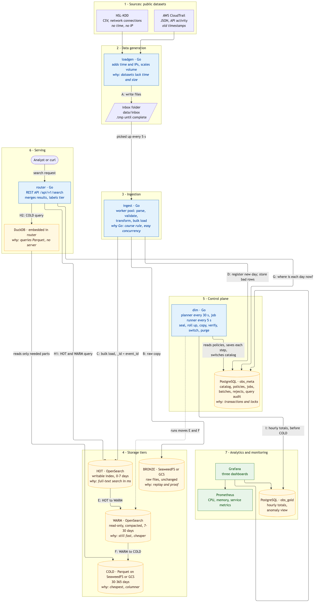

# Observability Fabric: end-to-end walkthrough

| Field | Value |
| --- | --- |
| Document ID | GUIDE-001 |
| Version | 1.2 |
| Status | Current |
| Audience | Team members, reviewers, and presentation viewers new to the system |
| Date | 2026-11-27 |
| Related | [Requirements](../design/requirements.md), [high-level design](../design/hld.md), [low-level design](../design/lld.md), [glossary](../glossary.md) |

This guide explains, in plain language, how one log record travels through
Observability Fabric from a dataset file to a search result. It describes the
built system; where it simplifies, the [high-level design](../design/hld.md)
and [low-level design](../design/lld.md) are authoritative.

## Table of contents

- [1. The idea in one paragraph](#1-the-idea-in-one-paragraph)
- [2. What each part is for](#2-what-each-part-is-for)
- [3. The datasets](#3-the-datasets)
- [4. Architecture diagram](#4-architecture-diagram)
- [5. The flow, step by step](#5-the-flow-step-by-step)
- [6. Detailed example](#6-detailed-example)
- [7. References](#7-references)
- [8. Revision history](#8-revision-history)

## 1. The idea in one paragraph

Think of a library that receives thousands of new pages every day. New pages
sit at the front desk, where they are quick to find but the space is
expensive. Older pages move to a back room, and very old pages go into boxes
in a cheap warehouse. A catalogue card always says where each page is right
now. Observability Fabric works the same way: new logs go into fast, costly
storage (HOT), a Go service called `dlm` moves them to cheaper storage (WARM,
then COLD) as they age, and every search reads the catalogue first. Because
the catalogue is only updated after a move has been checked, search keeps
working before, during, and after every move.

## 2. What each part is for

### 2.1 Components (the parts we build or run)

| Part | What it is | What it is for |
| --- | --- | --- |
| `loadgen` | Go program | Turns dataset rows into realistic log files: adds dates and IP addresses, and repeats data to reach a test volume |
| Inbox | A folder on disk (`/data/inbox`) | Drop-off point where `loadgen` leaves files and `ingest` collects them. Unfinished files end in `.tmp` |
| `ingest` | Go service | Checks every record, converts it to one common format, and loads it into HOT |
| Bronze | Folder in object storage | Permanent, unchanged copy of every input file, so data can be reloaded or checked later |
| HOT | OpenSearch index you can still write to | Newest data (default 0–7 days); fastest search |
| WARM | OpenSearch index made read-only and compacted | Older data (7–30 days); still fast, cheaper to keep |
| COLD | Parquet files in object storage | Old data (30–365 days); cheapest to keep, slower to search |
| Catalog | Table `data_partitions` in PostgreSQL | The address book: for each day of data, which tier it is in and where |
| `dlm` | Go service | Freezes finished days and moves them HOT → WARM → COLD, then deletes them after retention. Also keeps hourly totals for the dashboards |
| `router` | Go service with a REST API | Answers searches: asks the catalog, searches each tier, merges results |
| Dashboards | Grafana | Show health, volume, security events, cost, search speed, and move history |

### 2.2 Databases, tools, and technologies (and why)

| Technology | Used for | Why this one |
| --- | --- | --- |
| Go | All four programs (`loadgen`, `ingest`, `dlm`, `router`) | Required by the course; goroutines and channels make parallel work simple; small, fast programs |
| OpenSearch | HOT and WARM data | Builds a word index, so it finds text in millions of lines in milliseconds; open source (Apache 2.0); lets our Go code control every move |
| PostgreSQL, database `obs_meta` | Catalog, policies, move jobs, file batches, rejected rows, search audit | All-or-nothing transactions make the catalog switch safe; locks stop two `dlm` instances working at once |
| PostgreSQL, schema `obs_gold` | Hourly totals and unusual-spike flags for reports | Grafana reads it directly; summaries are small and quick to chart |
| Apache Parquet | COLD file format | Stores data by column and keeps min/max values per section, so a search can skip most of each file; compresses well |
| DuckDB | Searching (and writing) COLD files | A query engine that runs inside our Go program, with no server; reads only the parts of Parquet files it needs |
| SeaweedFS | Object storage on laptops | Free, maintained, S3-compatible, one container. Replaces MinIO, whose free edition is no longer maintained |
| Google Cloud Storage (GCS) | Object storage on Google Cloud (stretch goal) | Same cloud as GKE; cheap storage classes |
| Prometheus | Health numbers: CPU, memory, service up or down | Standard for monitoring; Go programs report their own metrics automatically |
| Grafana | Dashboards | Built for live operational dashboards; reads Prometheus and PostgreSQL |
| Docker and Docker Compose | Running everything on a laptop | Same setup on every machine; one command (`make up`) starts it all |
| GKE (Google Kubernetes Engine) | Cloud deployment (stretch goal) | Restarts stuck services automatically; real fast and cheap disk types for HOT and WARM |

### 2.3 Short forms

| Short form | Full form | Meaning here |
| --- | --- | --- |
| DLM | Data lifecycle management | Moving data to the right storage as it ages; also our `dlm` service |
| HOT, WARM, COLD | Storage tiers | Fast and costly, medium, slow and cheap |
| CSV | Comma-Separated Values | NSL-KDD file format |
| JSON | JavaScript Object Notation | CloudTrail file format |
| API | Application Programming Interface | How programs talk to the router |
| REST | Representational State Transfer | Style of web API (`GET /api/v1/search`) |
| SHA-256 | Secure Hash Algorithm, 256-bit | A fingerprint of a file or record |
| PIT | Point-in-time | An OpenSearch snapshot used to read a whole index consistently while copying it |
| DoS | Denial of Service | An attack that floods a server; NSL-KDD's "neptune" is one |
| GCS | Google Cloud Storage | Cloud object storage |
| GKE | Google Kubernetes Engine | Google's managed Kubernetes |
| p50, p95 | 50th and 95th percentile | Half of searches are faster than p50; 95 % are faster than p95 |
| ms, s | Milliseconds, seconds | Time units |

## 3. The datasets

The system uses two public datasets. They were chosen because they represent
two different kinds of log that IT and security teams search every day,
network traffic and cloud activity, in two different formats, CSV and JSON.
Neither is a live feed, so `loadgen` replays them as if they were arriving
now (step A).

### 3.1 NSL-KDD: network connection records

NSL-KDD is a well-known benchmark dataset for network intrusion detection.
Each row summarises one network connection, such as a web request or a login
attempt, and labels it as normal or as a specific attack. It was published in
2009 by the University of New Brunswick as a cleaned-up version of the older
KDD Cup 1999 dataset, which was built from simulated traffic on a test
military network in the 1998 DARPA intrusion-detection evaluation.

| Item | Detail |
| --- | --- |
| Publisher | University of New Brunswick, Canadian Institute for Cybersecurity (UNB CIC) |
| Files | `KDDTrain+.txt` (125,973 rows) and `KDDTest+.txt` (22,544 rows): comma-separated text with no header row |
| Columns | 43: 41 features, the attack label, and a difficulty level (how many of 21 test classifiers labelled the row correctly) |
| One row means | One network connection, summarised; not a raw packet |
| Size | Tens of megabytes |
| Dates and IP addresses | None. This is the main gap our design has to fill |
| Duplicates | Removed by the publishers. That was the main improvement over KDD Cup 1999 |
| Use | Free for research, citing Tavallaee et al. (2009) |

**The 41 features fall into four groups:**

| Group | Count | Examples | What they describe |
| --- | --- | --- | --- |
| Basic | 9 | `duration`, `protocol_type`, `service`, `flag`, `src_bytes`, `dst_bytes` | The connection itself |
| Content | 13 | `num_failed_logins`, `logged_in`, `root_shell` | What happened inside the connection |
| Time-based traffic | 9 | `count`, `serror_rate` | Connections to the same host in the last 2 seconds |
| Host-based traffic | 10 | `dst_host_count`, `dst_host_serror_rate` | The last 100 connections to the same host |

The `flag` column tells you how the connection ended. `SF` means it completed
normally, `S0` means a connection was attempted but never answered (typical
of a flood attack), and `REJ` means it was refused.

**Labels and attack categories in `KDDTrain+`:**

| Category | Rows | Share | Example labels | In plain words |
| --- | --- | --- | --- | --- |
| normal | 67,343 | 53.5 % | `normal` | Ordinary traffic |
| DoS (denial of service) | 45,927 | 36.5 % | `neptune`, `smurf`, `back`, `teardrop` | Flooding a server so it cannot answer real users |
| Probe | 11,656 | 9.3 % | `satan`, `ipsweep`, `portsweep`, `nmap` | Scanning to find targets and open ports |
| R2L (remote to local) | 995 | 0.8 % | `guess_passwd`, `warezclient` | An outsider gaining access to a machine |
| U2R (user to root) | 52 | 0.04 % | `buffer_overflow`, `rootkit` | A normal user taking administrator control |

By protocol, the training file has 102,689 TCP, 14,993 UDP, and 8,291 ICMP
connections. `KDDTest+` also contains some attack types that do not appear in
the training file.

**How we use it:**

- `loadgen` adds an event time and made-up source and destination IP
  addresses to each row, and marks it `is_synthetic = true`.
- `ingest` maps the label to a category, and the category to a severity:
  normal → `INFO`, Probe → `WARN`, DoS → `ERROR`, R2L and U2R → `CRITICAL`.
  The full field mapping is in [section 3.2 of the low-level design](../design/lld.md#32-source-mappings).
- To reach test volumes, `loadgen` replays the rows many times. Each replayed
  row gets a new timestamp and a new `event_id`.

**Limitations to keep in mind:**

- The traffic is from 1998 and was simulated, so it does not look like a
  modern network.
- Times and IP addresses are ours, not real, so charts over time show the
  patterns `loadgen` creates rather than real-world daily rhythms.
- R2L and U2R attacks are rare, so they barely show on volume charts.

### 3.2 AWS CloudTrail: cloud activity records

CloudTrail is the Amazon Web Services (AWS) service that records every action
taken in an AWS account: who did it, what they did, when, from where, and
whether it was allowed. AWS writes these records as compressed JSON files,
each holding a `Records` list, usually every few minutes. Security teams use
them to answer questions such as *who deleted this file?* or *who keeps
trying to read data they are not allowed to?*

**Key fields in each record:**

| Field | Meaning | Example | How we use it |
| --- | --- | --- | --- |
| `eventTime` | When it happened (UTC) | `2017-03-01T10:20:00Z` | `event_time`, after `loadgen` shifts it |
| `eventSource` | Which AWS service | `s3.amazonaws.com` | `service` |
| `eventName` | Which action | `GetObject`, `ListBuckets` | `event_name` |
| `userIdentity` | Who did it | `{"type": "IAMUser", "arn": "arn:aws:iam::…:user/alice"}` | `user_identity` (the `arn`) |
| `sourceIPAddress` | Where the request came from | `203.0.113.5`, or an AWS service name | `src_ip`, if it is an IP address |
| `awsRegion` | Which AWS region | `us-east-1` | `aws_region` |
| `errorCode` | Why it failed, if it failed | `AccessDenied` | `error_code`; any value sets severity `ERROR` |
| `userAgent` | Which tool made the request | `aws-cli/2.x` | Kept in `raw_message` |
| `requestParameters` | Details of the request | Bucket and file name | Kept in `raw_message` |

**Which dataset.** Real CloudTrail logs are rarely published, because they
reveal account details. The brief suggests Kaggle. The best-documented public
dataset is the one released by Summit Route from **flaws.cloud**, a free AWS
security training site whose account is attacked on purpose by learners.
This is our recommended source; the final choice is confirmed at milestone
M1.

| Item | Detail (flaws.cloud dataset) |
| --- | --- |
| Events | 1,939,207 |
| Time span | 12 February 2017 to 7 October 2020 (about 3.5 years) |
| Size | About 240 MB |
| Variety | 9,402 different IP addresses and 1,242 different AWS actions |
| Privacy | IP addresses and account IDs anonymised by the publisher |

**How we use it:**

- `loadgen` shifts every timestamp forward by the same amount so the data
  looks recent, and marks the events `is_synthetic = true`.
- `ingest` reads the `Records` list one record at a time, so a large file is
  never loaded into memory at once.
- A failed call (`errorCode` present) becomes category `api_error` with
  severity `ERROR`; a successful call becomes `api_ok` with severity `INFO`.

**Limitations to keep in mind:**

- It comes from a training site, so it is mostly attack activity rather than
  normal business use.
- `sourceIPAddress` is sometimes an AWS service name, such as
  `ec2.amazonaws.com`, rather than an IP address. We store `null` in `src_ip`
  in that case.
- It spans about 3.5 years, which is longer than our 365-day retention.

### 3.3 The two datasets side by side

| | NSL-KDD | AWS CloudTrail |
| --- | --- | --- |
| Kind of log | Network connections | Cloud activity (API calls) |
| Format | CSV, no header | JSON, `Records` list |
| Size | About 148,500 rows | About 1.9 million records |
| Has real timestamps | No (added by `loadgen`) | Yes (shifted by `loadgen`) |
| Has IP addresses | No (added by `loadgen`) | Yes (anonymised) |
| Labels attacks | Yes, every row | No; failures show as `errorCode` |
| Example search | "Show neptune attacks on 9 Nov" | "Who got `AccessDenied` on 9 Nov?" |
| Dashboard | Security events: attacks by category | Security events: failed calls |

## 4. Architecture diagram



Source: [`05-end-to-end-flow.mmd`](../diagrams/05-end-to-end-flow.mmd). Blue
boxes are Go services we write, yellow boxes store data, and green boxes are
monitoring tools. Letters A to H on the arrows match the steps in section 5.

## 5. The flow, step by step

### Step A: make realistic data (`loadgen` → inbox)

The public datasets ([section 3](#3-the-datasets)) are not ready to use as
live logs. NSL-KDD has no date or IP address on its rows, and CloudTrail
samples have old dates. Both are also far smaller than the volumes we want to
test.

- `loadgen` adds a date and made-up IP addresses to each NSL-KDD row, and
  shifts CloudTrail dates to recent days.
- It marks every such event `is_synthetic = true`, so no one mistakes it for
  real traffic.
- It writes files of about 100 MB, first as `name.tmp`, then renames them when
  complete, so `ingest` never reads a half-written file.

### Step B: keep the original (`ingest` → Bronze)

Before changing anything, `ingest` stores the file exactly as received in
Bronze.

- The file is named after its SHA-256 fingerprint, so the same file always
  gets the same name.
- If we later find a bug in our code, we fix it and reload from Bronze.

### Step C: check, convert, and load (`ingest` → HOT)

`ingest` reads each record, checks it, and translates it into one common
format so that both sources look alike.

- Good records get fields such as `event_time`, `source`, `category`,
  `severity`, and `src_ip`, plus an `event_id`.
- `event_id` is built from the file's fingerprint and the line number. Loading
  the same file twice gives the same IDs, so OpenSearch never stores
  duplicates.
- Bad records (for example, an impossible date) go to the `rejected_records`
  table with a reason, instead of disappearing.
- Records are sent to OpenSearch in batches of about 5 MB. If OpenSearch is
  busy, `ingest` waits and retries rather than crashing.

### Step D: register the day (`ingest` → catalog)

The first record for a new day creates that day's row in the catalog, and the
matching OpenSearch index.

- Example row: *9 Nov → tier HOT, index `logs-2026.11.09`, state OPEN*.
- A record that arrives for a day that is already frozen is rejected as
  `LATE_EVENT`.

### Step E: freeze and move to WARM (`dlm`, HOT → WARM)

Every 30 seconds, the `dlm` planner checks the catalog against the age rules.

- **Seal (freeze):** when a day has ended and has had no new writes for 2
  hours, `dlm` makes it read-only and records its row count.
- **Move:** when the day is 7 days old, `dlm` compacts the index, checks the
  row count is unchanged, then updates the catalog to WARM. The data stays in
  OpenSearch, so search stays fast.

### Step F: copy to cheap storage (`dlm`, WARM → COLD)

When a day is 30 days old, and its dashboard totals are final, `dlm` moves it
to Parquet files. This is the move that must never break search, so it
happens in careful stages, each saved in PostgreSQL:

1. **Copy:** read every event, write Parquet files to a temporary folder, and
   write the manifest (the packing list) last.
2. **Verify:** read the files back. The row count and a checksum must match
   the originals.
3. **Switch:** one transaction updates the catalog to COLD and points it at
   the manifest.
4. **Purge:** after a grace period, delete the WARM copy.

If anything fails in steps 1 or 2, the job rolls back and tries again. The
catalog still points to WARM throughout, so searches are not affected. If
`dlm` crashes, it restarts and continues from the saved step.

### Step G: ask the catalog first (`router` → catalog)

Every search starts with one question: where is each day in the requested
time range right now? The catalog answers, for example: *9 Nov is COLD, 15 Nov
is WARM, today is HOT*.

### Step H: search each tier and merge (`router` → tiers)

The router searches all the needed tiers at the same time.

- **H1:** HOT and WARM days are searched in OpenSearch, with a 5-second limit.
- **H2:** COLD days are searched with DuckDB, which reads only the needed
  parts of the Parquet files, with a 20-second limit.
- Results are merged by time, duplicates are removed, and each hit is
  labelled with its tier.
- If one tier fails or is too slow, the router still returns the rest, marked
  `PARTIAL`. Every search is recorded in `query_audit`.

### Alongside: dashboards

- `dlm` writes hourly totals per source and category to `obs_gold` while the
  data is still in OpenSearch; unusual spikes are worked out from those totals.
- Prometheus collects CPU, memory, and other health numbers from every
  service every few seconds.
- Grafana shows both on three dashboards: system health, storage and search,
  and security events.

## 6. Detailed example

### 6.1 The story

On **9 November 2026 at 10:15 UTC**, a company's server is flooded with fake
connection requests, a denial-of-service attack. Five minutes later, an AWS
user called *alice* tries to read a protected file and is refused. On **20
December**, a security analyst asks: *show me every attack from 9 November.*

Dates below use the default policy: HOT for 7 days, WARM until 30 days,
deleted after 365 days. Age is measured from the **end** of the day, so 9 Nov
is "7 days old" at the start of 17 Nov.

### 6.2 Step A: the raw rows and what `loadgen` adds

NSL-KDD row (shortened; it has 43 columns):

```text
0,tcp,private,S0,0,0,…,neptune,19
```

It says: a TCP connection to a private port that was never answered (`S0`),
labelled **neptune**, a DoS attack. It has no date and no IP address.
`loadgen` adds them in front:

```text
2026-11-09T10:15:00Z,10.4.2.7,172.16.0.9,0,tcp,private,S0,0,0,…,neptune,19
```

CloudTrail record (shortened), after `loadgen` has shifted its date:

```json
{
  "eventTime": "2026-11-09T10:20:00Z",
  "eventName": "GetObject",
  "eventSource": "s3.amazonaws.com",
  "userIdentity": { "arn": "arn:aws:iam::123456789012:user/alice" },
  "sourceIPAddress": "203.0.113.5",
  "awsRegion": "us-east-1",
  "errorCode": "AccessDenied"
}
```

Both are written into files in `/data/inbox/`, for example
`nslkdd-0007.csv` and `cloudtrail-0003.json`.

### 6.3 Steps B to D: what `ingest` stores

Bronze receives the original files unchanged:

```text
bronze/source=nslkdd/date=2026-11-09/3f8a9c…e21.csv
bronze/source=cloudtrail/date=2026-11-09/7b12d4…a90.json
```

Both records become events in the common format and are loaded into the HOT
index `logs-2026.11.09`:

| Field | Neptune record | Alice's record |
| --- | --- | --- |
| `event_id` | `7f3a…c1` (file fingerprint + line 41) | `b29e…04` (file fingerprint + record 3) |
| `event_time` | 2026-11-09 10:15:00 | 2026-11-09 10:20:00 |
| `source` | `nslkdd` | `cloudtrail` |
| `event_type` | `connection` | `api_call` |
| `category` | `DoS` | `api_error` |
| `severity` | `ERROR` | `ERROR` |
| `src_ip` | 10.4.2.7 | 203.0.113.5 |
| `protocol` / `service` | `tcp` / `private` | n/a / `s3.amazonaws.com` |
| `label` / `event_name` | `neptune` | `GetObject` |
| `user_identity` | n/a | `arn:aws:iam::123456789012:user/alice` |
| `is_synthetic` | `true` | `true` |

A broken row in the same file, with the date `2026-13-45`, is not loaded:

| `rejected_records` | Value |
| --- | --- |
| `reason` | `INVALID_TIMESTAMP` |
| `record_offset` | 58 |
| `raw_record` | `2026-13-45T10:00:00Z,10.1.1.1,…` |

The file's summary goes to `ingest_batches`, for example: 1,000,000 rows read,
999,990 loaded, 10 rejected, status `SUCCESS` (under 1 % rejected).

The first event of 9 Nov created this catalog row:

| `bucket_start` | `tier` | `state` | `location` | `doc_count` |
| --- | --- | --- | --- | --- |
| 2026-11-09 00:00 | HOT | OPEN | `logs-2026.11.09` | (not yet) |

### 6.4 Steps E and F: how the catalog row changes over time

| When | `tier` | `state` | `location` | What happened |
| --- | --- | --- | --- | --- |
| 9 Nov 10:15 | HOT | OPEN | `logs-2026.11.09` | First event loaded |
| 10 Nov 02:00 | HOT | SEALED | `logs-2026.11.09` | Day over and 2 hours with no writes: frozen, `doc_count` = 1,000,000 |
| 17 Nov 00:00 | WARM | SEALED | `logs-2026.11.09` | 7 days old: compacted, count checked, switched |
| 10 Dec 00:00 | COLD | SEALED | `cold/bucket=20261109T00Z/job=42/attempt=1/_manifest.json` | 30 days old: copied, verified, switched |
| 10 Dec 01:00 | COLD | SEALED | (same manifest) | Grace period over: WARM index deleted |
| 10 Nov 2027 | COLD | DELETED | (none) | 365 days old: files deleted after grace period |

The WARM → COLD job (job 42) in `migration_jobs` moves through these
statuses, each saved before the next starts:

| Time | `status` | Detail |
| --- | --- | --- |
| 00:00:05 | `PENDING` | Created by the planner |
| 00:00:10 | `COPYING` | 1,000,000 events read; 4 Parquet files written; manifest written last |
| 00:03:40 | `VERIFYING` | Files read back: 1,000,000 rows, checksum matches |
| 00:03:52 | `SWITCHING` | Catalog updated to COLD in one transaction |
| 00:03:52 | `PURGE_PENDING` | Waiting 1 hour so running searches finish on WARM |
| 01:03:55 | `DONE` | WARM index deleted |

**What if `dlm` crashes at 00:02:00, in the middle of copying?** Docker
restarts it. The job is still `COPYING`, so `dlm` deletes the half-written
files and copies again as attempt 2. During all of this the catalog still
says WARM, so the analyst's searches keep using OpenSearch and see no
difference.

### 6.5 Steps G and H: the analyst's search on 20 December

Request:

```text
GET /api/v1/search?q=neptune&from=2026-11-09T00:00:00Z&to=2026-11-10T00:00:00Z
```

1. The router asks the catalog about 9 Nov and is told: *COLD, manifest at
   `cold/bucket=20261109T00Z/job=42/…`*.
2. It reads the manifest to get the list of 4 Parquet files.
3. DuckDB reads only the parts of those files whose time range and text can
   match, and finds the neptune events.

Response (shortened):

```json
{
  "query_id": "6f1c0c1e-0d3a-4b8e-9a51-2f6a1d5b7c42",
  "status": "COMPLETE",
  "took_ms": 1450,
  "tiers": [{ "tier": "COLD", "partitions": 1, "took_ms": 1420, "hits": 100, "status": "OK" }],
  "hits": [
    {
      "event_id": "7f3a…c1",
      "event_time": "2026-11-09T10:15:00Z",
      "tier": "COLD",
      "source": "nslkdd",
      "severity": "ERROR",
      "raw_message": "0,tcp,private,S0,0,0,…,neptune,19"
    }
  ]
}
```

The same search on 10 November, while the day was HOT, would have come from
OpenSearch in tens of milliseconds. From COLD it takes about 1.5 seconds, but
storing the data costs far less. Measuring that trade-off answers the brief's
sample question on hot versus cold search speed. The latency figures here are
illustrative; real numbers come from the benchmark in
[section 10.3 of the low-level design](../design/lld.md#103-hot-versus-cold-benchmark).

### 6.6 What the dashboards show

| Dashboard | Example of what you would see |
| --- | --- |
| System health | All services up; `ingest` CPU 35 %, memory 210 MB; no failed moves; 9 Nov: 1,000,000 events, 10 rejected (`INVALID_TIMESTAMP`); job 42: WARM → COLD, 3 min 52 s, 1 attempt, `DONE` |
| Security events | 9 Nov 10:00–11:00: DoS count far above normal, **flagged as unusual** |
| Storage and search | GB per tier and monthly cost, against the cost if everything stayed HOT; p95 search time: HOT in milliseconds, COLD in seconds |

### 6.7 The demo version

In class we cannot wait 30 days, so the `demo` policy uses hours instead of
days: each partition is one hour, HOT for 1 hour, WARM until 3 hours,
deleted after 24 hours. `loadgen --backfill 6h` creates six hours of
back-dated data, and within about 10–15 minutes a single search over those
six hours returns results labelled HOT, WARM, and COLD together. Killing
`dlm` during a move shows that search keeps working and the move completes
after the restart.

## 7. References

1. M. Tavallaee, E. Bagheri, W. Lu, and A. A. Ghorbani, "A Detailed Analysis of the KDD CUP 99 Data Set", *IEEE Symposium on Computational Intelligence for Security and Defense Applications (CISDA)*, 2009.
2. University of New Brunswick, Canadian Institute for Cybersecurity, ["NSL-KDD dataset"](https://www.unb.ca/cic/datasets/nsl-kdd.html).
3. Amazon Web Services, ["CloudTrail record contents"](https://docs.aws.amazon.com/awscloudtrail/latest/userguide/cloudtrail-event-reference-record-contents.html).
4. S. Piper, ["Public dataset of Cloudtrail logs from flaws.cloud"](https://summitroute.com/blog/2020/10/09/public_dataset_of_cloudtrail_logs_from_flaws_cloud/), Summit Route, 2020.

## 8. Revision history

| Version | Date | Author | Change |
| --- | --- | --- | --- |
| 1.0 | 2026-11-11 | Group 6 | First version |
| 1.1 | 2026-11-11 | Group 6 | Added section 3 on the NSL-KDD and CloudTrail datasets, and references |
| 1.2 | 2026-11-27 | Group 6 | Matches the built system: `dlm` keeps the hourly totals (no `aggregator`), three dashboards; Prometheus without cAdvisor; internal identifiers replaced with plain words |
